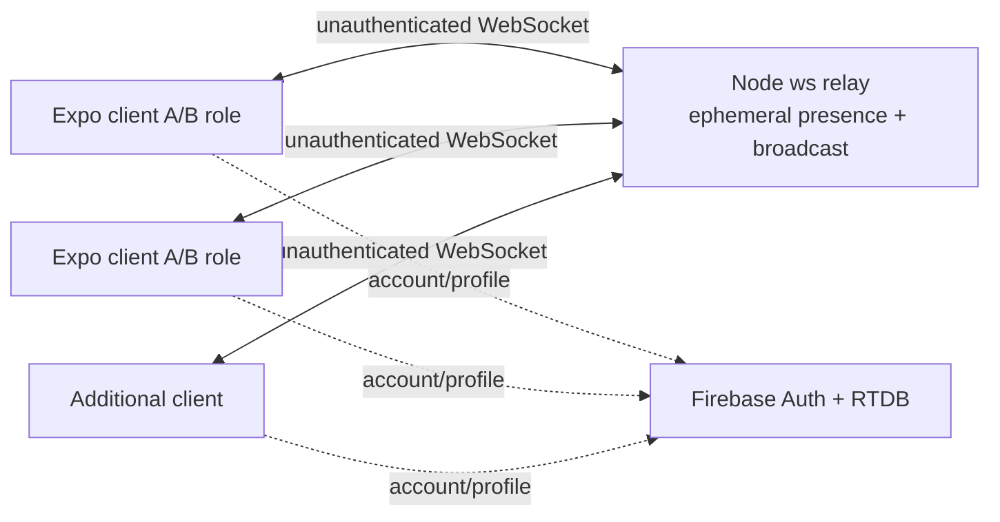

# NEXUS Implementation Audit — Final

Audit date: 2026-10-05  
Audited checkout: `main` at `a95f34636d9df537fa6df651f3c3eddaa676756d`  
Scope: code inspection, safe local execution, static validation, and controlled WebSocket tests. No production code, dependencies, Firebase data, or infrastructure were changed.

## 1. Executive Summary

NEXUS is an Expo 54 / React Native 0.81.5 prototype whose working center is a shared WebSocket client, a Node `ws` relay, ephemeral device-presence metadata, and two remotely triggered capabilities: vibration and flashlight. The relay was run locally and accepted three simultaneous clients. Messages from A reached both B and C, not A. The relay does not interpret `target`, authenticate connections, route by identity, or authorize capability use. Role filtering happens exclusively in clients.

The checkout is more advanced than the preliminary review in two respects: it contains a persistent random device-ID implementation and Firebase RTDB device-registry code, and it contains three automated Node tests. However, the registry is not started or imported by the app, the persistent device ID never enters the WebSocket protocol, and the tests are not exposed through a package script or CI. Consequently these additions do not provide remote identity, trust, or authorization.

`npm run lint` passed. The existing three-test suite passed. `npx tsc --noEmit` failed because `services/hooks.ts` is syntactically incomplete. No hardware execution was performed, so vibration and flashlight are code-connected but require the manual device tests below.

Final classification: **B — EARLY REUSABLE CORE**. The transport, basic presence, metadata collection, shared socket, and message validation are reusable but immature. Discovery, pairing, trust, sessions, individual routing, and authorization do not exist in the running remote flow.

## 2. Repository Snapshot

| Item | Observed state |
|---|---|
| Branch | `main`, tracking `origin/main` |
| HEAD | `a95f34636d9df537fa6df651f3c3eddaa676756d` (`autenticacion-002`) |
| Initial git status | Clean: `## main...origin/main` |
| Local changes | None before audit |
| Final pre-report status | Clean; only these two requested reports are added by the audit |
| Node | `v24.15.0` |
| npm | `11.12.1` via `npm.cmd`; PowerShell blocks `npm.ps1` under the host execution policy |
| Application | `app/` with Expo Router tabs for vibration, flashlight, devices, and account |
| Relay | `server/index.js`, `server/devicePresence.js` |
| Services | shared socket, presence, metadata, protocol, auth, device identity/registry |
| Configuration | `config/server.ts` is the single IP/port source; `.env` contains all seven expected Firebase key names |
| Tests | `tests/device-presence.test.cjs`; no `test` script in `package.json` |
| CI | No recognized CI configuration found |

Principal structure: `app/`, `components/`, `config/`, `hooks/`, `server/`, `services/`, `tests/`, plus Expo assets and configuration. `dist/`, `.expo/`, and `node_modules/` were present but excluded from source inventory. The inspected state corresponds to the current checkout above.

Version verification: `expo ~54.0.36`, `expo-router ~6.0.24`, React Native `0.81.5`, React `19.1.0`, TypeScript `~5.9.2`, `ws ^8.21.3`, Firebase `^12.19.0`, and `strict: true`. These align with the Expo 54 versioned reference (Expo 54 targets RN 0.81 and Node 20.19+).

## 3. Verification of Previous Findings

| Preliminary finding | Verdict | Current-checkout evidence |
|---|---|---|
| React Native application with Expo | CONFIRMADO | Expo dependency/config and RN 0.81.5. |
| Expo Router | CONFIRMADO | `main: expo-router/entry`, route files under `app/`. |
| React Native 0.81.x | CONFIRMADO | `0.81.5`. |
| Expo 54 | CONFIRMADO | `~54.0.36`. |
| TypeScript strict mode | CONFIRMADO | `tsconfig.json`; full compilation currently fails. |
| Own `ws` WebSocket relay | CONFIRMADO | Started successfully on configured port 8080. |
| Centralized WebSocket client | CONFIRMADO | Module-level singleton in `services/socket.ts`; test verifies repeated connect does not duplicate it. |
| Device presence | PARCIAL | Ephemeral, only after valid `DEVICE_INFO`; client snapshot represents one remote only. |
| Device-information exchange | CONFIRMADO | `DEVICE_INFO` and `DEVICE_INFO_REQUEST`; locally verified. |
| Relay heartbeat/ping-pong | PARCIAL | Verified ping for a client registered by `DEVICE_INFO`; unregistered connected clients are omitted. |
| Firebase Authentication | CONFIRMADO | Register, login, auth observer, logout are code-connected; no real account/network write was exercised. |
| Firebase Realtime Database | CONFIRMADO | User profile write/update/read code present; external operation not exercised. |
| Auth persistence via AsyncStorage | CONFIRMADO | `initializeAuth(...getReactNativePersistence(AsyncStorage))`. |
| Remote vibration | PARCIAL | Complete code path and relay transport; no physical actuator test. |
| Remote flashlight | PARCIAL | Complete code path with camera permission and `CameraView.enableTorch`; no physical actuator test. |
| Manual A/B roles | CONFIRMADO | Independent A/B state in vibration and flashlight screens. |
| Local/remote device information | CONFIRMADO | UI and transport integrated; hardware values not independently validated. |
| Manual relay IP | CONFIRMADO | `config/server.ts`; no automatic selection. |
| No automatic discovery | CONFIRMADO | No discovery mechanism found. Presence after manual relay connection is not network discovery. |
| No complete pairing/trust model | CONFIRMADO | No pairing or trust state/protocol. |
| No formal capability negotiation | CONFIRMADO | A static capability declaration exists in dormant `deviceRegistry.ts`, but there is no runtime offer/request/accept negotiation. |
| No formal NEXUS session entity | CONFIRMADO | Connections exist without session object, owner, lifecycle, or membership. |
| No device/capability authorization | CONFIRMADO | Relay broadcasts; clients accept commands by role/shape only. |
| Firebase identity absent from WebSocket/authorization | CONFIRMADO | No UID/token/device ID sent to relay. |
| Relay retransmits rather than authenticated-session routing | CONFIRMADO | Three-client test proves broadcast to B and C. |
| UI/commands fundamentally assume A/B | CONFIRMADO | Vibration uses symmetric A/B; flashlight is fixed A→B. |
| No significant automated tests in `package.json` | PARCIAL | No test script, but one file contains three meaningful Node tests. |
| No CI checks | CONFIRMADO | No recognized CI definition found. |
| Product is essentially “Remote Capability Demo” | CONFIRMADO | UI labels itself so; implemented behavior matches. |
| No persistent device identity | CORREGIDO | AsyncStorage UUID and RTDB registry code exist, but registry is not started and identity is absent from WebSocket. Runtime status remains partial. |

## 4. Static Validation

| Command | Result | Relevant errors | Impact |
|---|---|---|---|
| `npm.cmd run lint` | PASS, exit 0 | None | ESLint accepts current included source. |
| `npx.cmd tsc --noEmit` | FAIL, exit 1 | `services/hooks.ts(6,1): TS1005 '(' expected`; `(13,1): TS1005 ')' expected` | The repository does not pass full strict TypeScript validation. The file is incomplete/invalid. |
| `node --test tests/device-presence.test.cjs` | PASS, 3/3 | None | Covers presence replay/broadcast/disconnect, metadata validation, and shared-socket singleton behavior. |

The test command is documented in README but absent from `package.json`. No source error was repaired.

## 5. Relay Validation

The production relay was started unmodified with `npm.cmd run relay`; it listened on `ws://0.0.0.0:8080`. A temporary audit client connected to `ws://127.0.0.1:8080`; the temporary file was removed afterward.

| Behavior | Result | Evidence |
|---|---|---|
| Server starts | PASS | Listening event/log on port 8080. |
| Accepts WebSocket connections | PASS | All audit clients opened. |
| At least two simultaneous clients | PASS | Three clients A/B/C connected concurrently. |
| Message reaches another client | PASS | Capability command from A reached B. |
| Message not echoed to sender | PASS | A received 0 copies of its command. |
| `DEVICE_INFO` | PASS | A info reached B and C with server-assigned connection ID. |
| `DEVICE_INFO_REQUEST` | PASS | C requested and received A's stored info. |
| `DEVICE_LEFT` | PASS | After A closed, B and C received the departure. Client-originated `DEVICE_LEFT` is swallowed by design. |
| Disconnect behavior | PASS | Registered device removed and departure broadcast. |
| Heartbeat | PARTIAL | After a valid `DEVICE_INFO`, B observed one server ping after ~30 seconds and automatically ponged. Connected C, which had not published info, observed no ping. Termination of a non-ponging device was not separately forced. |

Presence storage and connection IDs live only in relay memory. A clean close is immediate; an abrupt failure for a registered client can take roughly two heartbeat intervals to terminate. No application-level reconnect exists.

## 6. Three-Client Routing Test

Test command payload:

```json
{"type":"CAPABILITY_COMMAND","from":"A","target":"B","capability":"vibration","action":"vibrate","duration":5000}
```

Observed counts: A `0`, B `1`, C `1`.

- Does B receive it? **YES.**
- Does C receive it? **YES.**
- Does the server interpret `target`? **NO.** It only special-cases presence message types.
- Does the server route by identity? **NO.**
- Does it broadcast? **YES**, to every other open client.
- Is A/B selection only client-side? **YES.** Receiving app screens decide whether to act based on locally selected role.

Consequences: with more than one client selecting B, every such client can execute the same command. A client selecting neither role still receives the command but its screen filters it. The device-presence UI is also two-device-shaped: each new valid `DEVICE_INFO` overwrites the single `remote` snapshot and `remoteId`, even though the relay can hold several entries.

## 7. Identity Model

| Identity | Creation | Lifetime/persistence | Known by | Firebase UID / physical device / session | Authorization role |
|---|---|---|---|---|---|
| User identity | Firebase email/password registration/login; UID issued by Firebase | Firebase Auth persistence via AsyncStorage until logout/expiry | Firebase and app/account UI | UID is the identity; not linked into WebSocket or a NEXUS session | None in remote flow |
| Device identity | `Crypto.randomUUID()` in `getOrCreateDeviceId()` | AsyncStorage key `@nexus/device-id`; survives app restarts, but reset/reinstall behavior is storage-dependent | Only dormant registry path and RTDB if explicitly invoked | Stored under `devices/{uid}/{deviceId}` when invoked; software-install identity, not verified hardware identity; no session link | None |
| WebSocket connection identity | Relay `randomUUID()` on connect | Ephemeral for one socket; not sent until presence messages | Relay; peers see it on `DEVICE_INFO`/`DEVICE_LEFT` | Not linked to UID, persistent device ID, hardware, or session | None |
| Role A/B | User selects separately on each capability screen | Component memory only; lost on remount/restart | Local UI; role label may be broadcast as metadata | Not tied to UID, physical identity, connection identity, or session | Client-side command filter only; not security |

**Does NEXUS currently possess a persistent device identity? PARCIAL.** The implementation exists, but the registry is not started anywhere and the ID is not used by the live remote protocol.

**Can the server know which Firebase user owns a WebSocket connection? NO.**

**Can the server verify that A has the right to execute a capability on B? NO.**

## 8. Authentication / Trust / Authorization

Authentication proves an account identity. Pairing establishes a device relationship. Trust records an accepted relationship. Authorization decides whether an authenticated principal may perform an action. NEXUS implements only the first for the account subsystem; it does not carry that proof into remote capability traffic.

| Concept | Implemented | Applied to remote flow | Evidence |
|---|---|---|---|
| Authentication | YES | NO | Firebase Auth register/login/logout and persisted session. |
| Device identity | PARTIAL | NO | Persistent UUID code and dormant RTDB registry; ephemeral relay UUID is not authenticated. |
| Pairing | NO | NO | No request/accept relationship or stored pair. |
| Trust | NO | NO | No trust state or proof. |
| Authorization | NO | NO | No server policy; any connected client may broadcast commands. |
| Capability permission | PARTIAL | PARTIAL | Camera OS permission gates flashlight locally; no user-to-device capability grant. Vibration validates shape/duration only. |
| Session ownership | NO | NO | No NEXUS session entity or owner. |
| Revocation | NO | NO | Disconnect/logout do not revoke a grant because no grant exists. |

## 9. Discover → Trust → Borrow → Use → Return

| Stage | Classification | Current reality |
|---|---|---|
| DISCOVER | SIMULADO | Manually connected clients exchange presence through a known relay; no automatic network/service discovery. |
| TRUST | AUSENTE | No acceptance, credential binding, or trust record. |
| BORROW | AUSENTE | No request/approval, lease, scope, or time bound. Static metadata can claim capabilities but does not negotiate them. |
| USE | REAL | Valid role-filtered messages can call vibration or toggle torch in application code. Transport was verified; hardware actuation was not. |
| RETURN | AUSENTE | No explicit close/release/revoke lifecycle. Flashlight UI may turn off on focus/role changes, but that is not return semantics. |

## 10. Implemented Capabilities

### Vibration

- UI entry: vibration tab; user chooses A or B, connects, then targets the opposite role.
- Message: `CAPABILITY_COMMAND`, `from`, `target`, `capability: vibration`, `action: vibrate`, integer duration (sender uses 5000 ms).
- Validation: receiver requires A/B, opposite roles, exact capability/action, integer duration from 1–10000 ms.
- Transport: shared socket → relay broadcast to every other open socket.
- Reception/execution: clients filter by locally selected target role, then call React Native `Vibration.vibrate(duration)`.
- OS permission: no explicit runtime permission flow in source. Actual platform/device behavior was not tested.
- Direction: A→B and B→A are logically allowed.
- 3+ clients: all receive; every client locally selecting the target role may execute.
- Status: **CODE PRESENT: YES; LOGICALLY CONNECTED: YES; LOCALLY VERIFIED: transport/protocol only; REAL HARDWARE: NOT TESTED.**

### Flashlight

- UI entry: flashlight tab; A gets on/off controls; B mounts a hidden rear `CameraView` and a manual torch test.
- Message: fixed `from: A`, `target: B`, capability `flashlight`, action `flash_on`/`flash_off`.
- Validation: exact fixed direction and action; B role required locally.
- Transport: same shared socket and broadcast relay.
- Reception/execution: B checks camera permission, changes `torchEnabled`, and passes it to `CameraView.enableTorch`.
- OS permission: `useCameraPermissions`; `app.json` declares an Expo Camera permission explanation. The rear camera must mount successfully and support torch.
- Limitations: camera readiness is displayed but not part of command acceptance; no acknowledgement confirms physical light state. Screen focus/role changes disable local torch state.
- Direction: A→B only.
- 3+ clients: every connected client receives; every eligible B can execute.
- Status: **CODE PRESENT: YES; LOGICALLY CONNECTED: YES; LOCALLY VERIFIED: transport/protocol only; REAL HARDWARE: NOT TESTED.**

## 11. Firebase Role

Verified in source:

- Initialization requires seven `EXPO_PUBLIC_FIREBASE_*` variables: API key, auth domain, database URL, project ID, storage bucket, messaging sender ID, and app ID. All key names exist in local `.env`; values were deliberately not printed.
- Firebase app, Authentication, and RTDB are initialized in `app/firebase.ts`.
- React Native Auth persistence uses AsyncStorage, with `getAuth` fallback if already initialized.
- `registerUser` creates email/password auth and writes `users/{uid}` with email, `createdAt`, and `lastLoginAt`.
- `loginUser` authenticates and updates `lastLoginAt`; `logoutUser` signs out.
- Account UI observes Auth and reads `users/{uid}` with `onValue`.
- Device-registry code can write `devices/{uid}/{deviceId}`, but `startDeviceRegistry` has no caller in the checkout.

No production write, account creation, or external Firebase read was performed. Therefore external rules, credentials, and deployed behavior are **NO VERIFICABLE** here.

NEXUS Core remote transport does not depend on Firebase: the relay imports only server config, presence, protocol validation, Node crypto, and `ws`; it ran and relayed messages without authentication. The application bundle does import Firebase initialization from the root layout via `firebaseTest`, so starting the complete app requires configuration variables even though capability messages themselves do not use Firebase.

**Can the WebSocket relay function without Firebase? YES, locally verified.**

## 12. Actual Architecture

Best topology: **CLIENT → RELAY → CLIENT**, with a separate Firebase backend used for accounts/profiles but not in the relay data path. It is not peer-to-peer: clients never connect directly to each other. It is not an authenticated application backend: the relay holds ephemeral presence and broadcasts opaque non-presence messages.



### Coupling and reuse

| Subsystem | Coupling | Reusable portion |
|---|---|---|
| UI | HIGH | Themed primitives only; feature screens encode A/B demo behavior. |
| WebSocket client | LOW | Singleton connection/status/pub-sub service, tied only to `SERVER_CONFIG`. |
| Relay server | LOW | Generic fan-out and presence attachment, though unauthenticated. |
| Device presence | MEDIUM | Protocol/validation reusable; client store is single-remote. |
| Device metadata | MEDIUM | Collector/card/protocol reusable within Expo-supported platforms. |
| Vibration | HIGH | Validator/executor pattern is reusable; capability itself is prototype-specific. |
| Flashlight | HIGH | Camera/torch mechanism reusable; fixed A→B flow is product-specific. |
| Firebase Authentication | MEDIUM | Conventional account service reusable; root app currently initializes it globally. |
| RTDB | MEDIUM | User profile shape and dormant device record are separable but schema-specific. |

## 13. NEXUS Core

| Candidate element | Classification | Evidence-based assessment |
|---|---|---|
| Transport | USABLE BUT IMMATURE | Working singleton client and relay fan-out; no TLS/auth/routing/reconnect. |
| Presence | USABLE BUT IMMATURE | Join info, replay, departure, heartbeat for registered clients. |
| Device metadata | USABLE BUT IMMATURE | Broad collection and strict wire-shape validation; platform gaps expected. |
| Device registry | EXPERIMENTAL | Persistent ID/RTDB record code exists but is not started. |
| Identity | NOT YET CORE | User, device, connection, and role identities are disconnected. |
| Capability protocol | EXPERIMENTAL | Typed JSON conventions exist independently in two screens, not a shared negotiated protocol. |
| Capability execution | EXPERIMENTAL | Two real platform calls, hardware unverified and role-bound. |
| Session lifecycle | NOT YET CORE | Absent. |
| Trust | NOT YET CORE | Absent. |
| Authorization | NOT YET CORE | Absent. |
| Firebase integration | USABLE BUT IMMATURE | Auth/profile code-connected; external behavior untested; disconnected from remote flow. |
| Network configuration | EXPERIMENTAL | Correctly centralized, but manual IP and plain `ws://`. |

## 14. Core vs Prototype vs Product UX

| Element | Classification | Reason |
|---|---|---|
| Shared socket and relay | CORE / INFRASTRUCTURE | Generic messaging substrate. |
| Presence server and metadata protocol | CORE / INFRASTRUCTURE | Generic device visibility, albeit immature. |
| `SERVER_CONFIG` | CORE / INFRASTRUCTURE | Central configuration; its manual values are deployment-specific. |
| Firebase auth/profile | CORE / INFRASTRUCTURE | Generic account infrastructure, currently independent of remote core. |
| Persistent device-ID/registry code | EXPERIMENTAL | Not integrated into application lifecycle or socket identity. |
| Vibration | CAPABILITY PROTOTYPE | Demonstrates remote actuation. |
| Flashlight | CAPABILITY PROTOTYPE | Demonstrates permission-gated remote actuation. |
| Vibration/flashlight screens | PRODUCT UX | UI for the current demo. |
| Device screen | PRODUCT UX | Useful diagnostic UI, but hard-coded to one remote. |
| Account screen | PRODUCT UX | Account/demo UI over Firebase. |
| A/B roles | LEGACY / TEMPORARY | Local demo addressing, not stable identity. |
| `services/hooks.ts` | LEGACY / TEMPORARY | Incomplete unused fragment that breaks TypeScript. |

Components that should not constrain future product definition merely because they exist: A/B role naming; the opposite-role vibration rule; fixed A→B flashlight direction; vibration duration of five seconds; `CAPABILITY_COMMAND`'s current exact shape; single-remote presence state; current tabs/screens; Firebase as the remote authority (it is not one); manual IP UX; the “borrow” vocabulary (not implemented); the two selected actuator capabilities.

## 15. Real End-to-End Flows

| Color | Implemented flow | Boundary of verification |
|---|---|---|
| GREEN | Start relay → connect multiple WebSocket clients → broadcast opaque message to all except sender | Verified with real relay and A/B/C clients. |
| GREEN | Client publishes valid device info → relay stores it by socket → peers receive it → late client requests/replays it | Verified locally and in automated test. |
| GREEN | Registered socket closes → relay deletes its info → peers receive server-generated `DEVICE_LEFT` | Verified locally. |
| GREEN | Registered client remains connected → relay sends ping → compliant client pongs | Ping observed locally; non-pong termination not forced. |
| YELLOW | Select role → send vibration command → relay broadcasts → target-role client validates → `Vibration.vibrate` | Code complete; transport verified; physical vibration unverified. |
| YELLOW | A sends flash command → relay broadcasts → B validates/permission-checks → `CameraView.enableTorch` changes | Code complete; transport verified; permission/camera/torch hardware unverified. |
| YELLOW | Register/login → Auth persists → `users/{uid}` write/read → logout | Code connected; external Firebase interaction deliberately untested. |
| RED | Authenticated user → persistent device registration | Registry code exists but is not started. |
| RED | Authenticated session → authorized targeted capability execution | Authentication is not connected to WebSocket and server routing/authorization are absent. |

## 16. Product-Relevant Technical Debt

| Debt | Severity | Product consequence |
|---|---|---|
| Broadcast instead of individual routing | BLOCKER | Prevents private, deterministic target control in N-device use. |
| No authenticated WebSocket identity/authorization | BLOCKER | Any network client can send commands; server cannot enforce ownership or consent. |
| No pairing/trust/session lifecycle | BLOCKER | Multi-user or persistent relationships have no enforceable semantics. |
| A/B-only client model and single-remote presence state | IMPORTANT | Two-device demo is natural; N-device UX/behavior is ambiguous and lossy. |
| Manual LAN IP and plain `ws://` | IMPORTANT | Deployment, reachability, mobility, and transport security constrain product setting. |
| Persistent device registry not integrated | IMPORTANT | Existing identity asset does not solve live routing or ownership. |
| No capability negotiation/acknowledgement | IMPORTANT | Declared support and actual execution cannot be reliably coordinated. |
| No reconnect/backoff or command delivery acknowledgement | IMPORTANT | Failure recovery is manual and command outcome is unknown. |
| Heartbeat covers only info-publishing connections | IMPORTANT | A connected but unregistered socket is not liveness-managed by this mechanism. |
| Full TypeScript check fails | IMPORTANT | Baseline build-quality signal is red. |
| Tests not scripted in package manager; no CI | IMPORTANT | Regressions are not automatically gated. |
| Hardware/platform behavior not verified | IMPORTANT | Product claims for actuators and permissions remain uncertain. |
| Firebase account subsystem separate from remote core | TOLERABLE | Can remain optional for experiments, but cannot be mistaken for remote security. |
| Starter/example UI files and styling details | IRRELEVANT FOR PRODUCT DECISION | Do not change core feasibility. |

## 17. Scalability / Topology

- **Two devices:** this is the intended and most natural current model. A/B controls, one remote snapshot, and opposite-role filtering align with it.
- **N devices:** relay transport technically accepts N sockets, but semantics do not. Every message fans out, presence UI retains only one remote, and roles collide.
- **One controller + N nodes:** flashlight accidentally approximates this if all nodes are B, but every B executes together and none is individually addressable.
- **N symmetric devices:** not designed. Vibration is directionally symmetric only between two labels; identity, membership, routing, and per-device state are absent.

The central relay makes fan-out technically natural. The A/B client state makes a two-role broadcast group much more natural than individual N-device control. No benchmark was attempted.

### 10 VERIFIED TECHNICAL FACTS

1. NEXUS has a working generic WebSocket relay path that forwards non-presence messages to all open peers except the sender.
2. The relay accepted three simultaneous local clients.
3. A command marked `target: B` reached both B and C; the relay does not route by `target`.
4. Valid device metadata is stored in relay memory per registered socket and replayed on request.
5. Registered device departure is announced by a server-generated ephemeral connection UUID.
6. The relay heartbeat pings clients that have published valid device info.
7. Vibration and flashlight command handlers are logically connected to React Native platform APIs.
8. Firebase email/password authentication and RTDB user-profile operations are integrated in the account UI but not the socket flow.
9. A persistent random device-ID and RTDB registry implementation exists but is not started by the app.
10. Lint and the three existing Node tests pass; full TypeScript validation fails on `services/hooks.ts`.

### 10 TECHNICAL CONSTRAINTS

1. Relay reachability depends on a manually configured IP/port.
2. Transport uses unauthenticated plain `ws://`.
3. All non-presence traffic is broadcast, never individually routed.
4. Remote commands carry self-asserted A/B labels rather than verified identity.
5. The server cannot associate a socket with a Firebase UID or persistent device ID.
6. The client presence model stores only one remote device.
7. No pairing, trust, session ownership, or revocation exists.
8. Capability support is not negotiated and execution is not acknowledged.
9. Recovery after local socket loss is manual; no reconnect policy exists.
10. Device actuator behavior remains dependent on real hardware, platform support, permission, and foreground/camera state.

### 5 TECHNICAL OPPORTUNITIES

1. Reuse the verified relay/socket path as an experimental multi-device messaging substrate.
2. Reuse presence replay and validated device metadata for device-aware prototypes.
3. Reuse the capability message/validator/executor pattern independently of the two current actuators.
4. Reuse Firebase account/profile code where a future product genuinely needs accounts.
5. Investigate the existing persistent device-ID/registry code as an asset, while recognizing that it is currently disconnected from transport.

### ACCIDENTAL PRODUCT CANDIDATES

1. **Synchronized local actuator group.** Evidence: one command already fans out to all peers and all clients selecting the target role may act. Existing infrastructure: relay, role filters, vibration/torch executors. Missing: hardware proof, group semantics, safety/consent, delivery status. Worth investigating because broadcast—currently a routing defect—already implements simultaneous group fan-out.
2. **Temporary device-status board.** Evidence: metadata collection, presence replay, periodic refresh, and departure notification work. Existing infrastructure: collector, validated wire record, relay memory, device card. Missing: N-device client model, stable identity integration, stale-state semantics. Worth investigating because observation requires less actuation authority than remote control.
3. **Two-device local remote control.** Evidence: explicit A/B flows for two physical capabilities and shared connection service. Existing infrastructure: controls, validation, relay, OS adapters. Missing: hardware validation, secure relationship/consent, reliable delivery. Worth investigating because it is the narrowest behavior the code already models end to end.

### Product-direction compatibility

| Product direction | Reuse | Missing core | Technical fit |
|---|---|---|---|
| A. Distributed audiovisual production | MEDIUM | Time synchronization, media transport, routing, session/control model | LOW |
| B. Distributed sensors/measurement | MEDIUM | Sensor protocols, timestamping, aggregation, N-device registry, reliability | MEDIUM |
| C. Remote observation/monitoring | MEDIUM | Secure remote reachability, persistent N-device state, alerts/history | MEDIUM |
| D. Multi-device education/labs | MEDIUM | Session membership, orchestration, N-device UI, safety controls | MEDIUM |
| E. Robotics/research | LOW | Deterministic control, telemetry, safety, authorization, device adapters | LOW |
| F. Temporary infrastructure with existing phones | HIGH | Discovery/onboarding, N-device sessions, routing, resilient deployment | HIGH |
| G. Remote control of device capabilities | HIGH | Identity, pairing, authorization, capability negotiation, acknowledgements | HIGH |

## 18. Reality Matrix

| Capability/Subsystem | Code | Integrated | Local verified | Device verified | Reusable | Product relevance |
|---|---|---|---|---|---|---|
| WebSocket relay | YES | YES | YES | UNKNOWN | YES | YES |
| WebSocket client | YES | YES | YES | UNKNOWN | YES | YES |
| Device presence | YES | YES | YES | UNKNOWN | PARTIAL | YES |
| Device metadata | YES | YES | YES | NO | YES | YES |
| Vibration | YES | YES | PARTIAL | NO | PARTIAL | YES |
| Flashlight | YES | YES | PARTIAL | NO | PARTIAL | YES |
| Firebase Auth | YES | YES | NO | NO | YES | PARTIAL |
| Firebase RTDB profile | YES | YES | NO | NO | YES | PARTIAL |
| Persistent user identity | YES | YES | NO | NO | YES | PARTIAL |
| Persistent device identity | YES | NO | NO | NO | PARTIAL | YES |
| Discovery | NO | NO | NO | NO | NO | YES |
| Pairing | NO | NO | NO | NO | NO | YES |
| Trust | NO | NO | NO | NO | NO | YES |
| Capability negotiation | PARTIAL | NO | NO | NO | PARTIAL | YES |
| Capability authorization | NO | NO | NO | NO | NO | YES |
| Session lifecycle | NO | NO | NO | NO | NO | YES |
| Individual routing | NO | NO | NO | NO | NO | YES |
| Failure recovery | PARTIAL | PARTIAL | PARTIAL | NO | PARTIAL | YES |

## 19. Manual Device Tests

Only tests that require the real mobile environment remain here.

| TEST | STEPS | EXPECTED RESULT | PASS CRITERIA |
|---|---|---|---|
| Vibration A→B | Same relay; choose vibration A/B; connect both; send from A | B vibrates ~5 s; A does not | Exactly B actuates and UI records receipt |
| Vibration B→A | Reverse roles and send from B | A vibrates ~5 s; B does not | Exactly A actuates |
| Flashlight A→B | Choose flashlight A/B; grant B camera permission; connect; send on/off | B rear torch follows both commands | Physical light turns on then off; A does not |
| Permission denial | Deny camera permission on B; send `flash_on` | No torch; B reports permission requirement | No physical actuation and clear local message |
| Device information | Connect two phones; open Devices; refresh | Each shows local and peer metadata | Both show plausible peer model/OS/state |
| Disconnect/reconnect | Close/network-drop B, wait up to ~65 s, then reconnect manually | A reports departure; B can reconnect and republish | State changes without relay restart; metadata returns |
| Two Firebase users | Authenticate a different prepared test user on each phone; avoid production accounts | Accounts remain distinct; remote capability still connects independently | UIDs differ and capability behavior shows no auth-based gating |
| Third device | Connect A, B, C; set B and C to target role; send one command | Both target-role phones may actuate; device screen may show only last remote | Observed behavior matches broadcast/single-remote finding |

## 20. Final Technical Classification

**B — EARLY REUSABLE CORE**

The relay/socket channel, presence exchange, metadata collector, and validation patterns are real and locally verified. They form reusable infrastructure, not merely static mockups. However, routing is broadcast; persistent device identity is dormant; Firebase identity is disconnected from transport; and pairing, trust, authorization, sessions, negotiation, acknowledgements, and robust recovery are absent. The A/B UI and the two capabilities are prototype-specific. Pivot cost is therefore **MEDIUM**: transport and device-awareness assets can survive, but any product requiring secure or deterministic multi-device behavior cannot treat the current semantics as finished core.
